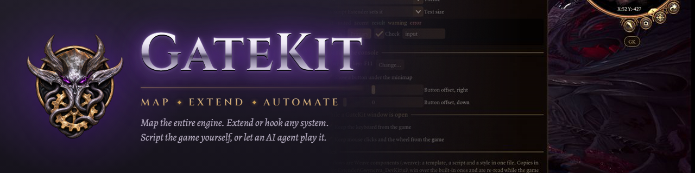

<p align="center">
  
</p>

<p align="center">
  
  
  
</p>

# GateKit

<p align="center">
  <a href="research/coverage/registers.md"><b>Map</b></a> ·
  <a href="mods/GateKit"><b>Extend</b></a> ·
  <a href="docs/driving-the-game.md"><b>Automate</b></a>
</p>

Tools for developing Baldur's Gate 3 mods without babysitting the game: the game starts by
itself, your Lua reloads while it runs, and everything in it can be read and driven from code —
by you, by a test, or by an AI agent.

**[Map](research/coverage/registers.md)** the engine: what it is made of and how far we have got,
in one table with no invented percentage in it. The same facts are browsable at
[the map site](https://map.gk.gwynerva.net/), a page per object with a `.json` beside it.
**[Extend](mods/GateKit)** it: the bridge mod and a [Script Extender
fork](https://github.com/bg3gk/bg3se) that opens up the parts of the engine the stock one does
not reach. **[Automate](docs/driving-the-game.md)** it: every one of those parts as a function
call, from a test, a script or an agent.

## How far we have got

Measured on 2026-11-13, not estimated — and deliberately as counts rather than one percentage,
because [a single number would say more than we can defend](docs/design/coverage-measure.md).

| | |
|---|---|
| The engine's ECS component types | **2,101 of 2,647** seen alive, 995 of them checked against raw memory |
| Its systems, queries and globals | 934 / 4,841 / 28 enumerated; described: barely begun |
| The game's own content, indexed offline | 25,560 templates, 16,593 stats entries, 9,386 dialogues with 187,213 nodes |
| The engine's functions | 393,159 found, ~10,400 given a name |
| Driving the game from code | 45 honest player actions, 40 ways to perceive, 33 to work its windows |
| Copies at once | as many as the machine takes, each in a tile, capped and muted but one |

[What this is for](docs/design/what-this-is-for.md) says why the mapping is worth doing at all,
and [what we publish](docs/design/what-we-publish.md) where the line runs between our findings
and Larian's content.

> **Experimental.** GateKit is in active development and is not production-ready. Commands, the
> Lua API and file formats change without notice; expect breakage between versions.
>
> **How it is built.** GateKit is developed mostly by AI coding agents (Claude) working under
> the continuous direction and review of [@Gwynerva](https://github.com/Gwynerva), who decides
> what is built and approves every change. Commits written by agents carry a `Co-Authored-By`
> line.

## What it gives you

- **A game that starts by itself**, straight into a test level in about 40 seconds: no Steam
  window, no launcher, no logo video, no menu, only the mods under test.
- **Hot reload**: change a mod's Lua, see it live in the running game in about a second.
- **Everything as function calls**: the party, equipment, scenes, dialogues, the engine's own
  components — read and driven from outside the game, returning JSON. No screenshots involved.
- **Several games at once**, isolated from each other and from your own installation, so agents
  and you can work side by side.
- **Scenarios**: write a test in Lua, run the suite, get pass or fail. A world reset takes about
  14 seconds instead of a restart.
- **An MCP server**, so an AI agent can do all of the above through its own tools.
- **An in-game console** (F11) and [**Weave**](mods/Weave) — windows written like web pages,
  for your own mods.
- **Offline knowledge**: an index of the game's own data and a symbol database built from the
  official Toolkit, for answering questions without starting anything.
- **Your saves and settings stay yours**: everything the stand changes is put back.

| | Windows | Linux | macOS |
|---|---|---|---|
| Host (`gatekit`, MCP, offline tools) | yes | yes | planned |
| Driving the game | yes | through Proton (written, not yet tested on hardware) | planned |
| Official Toolkit bridge | yes | — | — |

## Quick start

You need [.NET 10](https://dotnet.microsoft.com/download), your own copy of Baldur's Gate 3
(Patch 8), and [Script Extender](https://github.com/Norbyte/bg3se).

```bash
dotnet build
./gatekit doctor
./gatekit up --level GustavX:TUT_Avernus_C
./gatekit exec server "return GK.Party()"
./gatekit down
```

Three ways in:

- **A modder** → [docs/getting-started.md](docs/getting-started.md): from nothing to your own
  mod reloading live in the game.
- **An AI agent** driving the game → [docs/driving-the-game.md](docs/driving-the-game.md).
  An agent working on GateKit's own code reads [AGENTS.md](AGENTS.md) instead. The repository's `.mcp.json` already registers the server
  (`gatekit mcp`, [src/GateKit.Mcp](src/GateKit.Mcp/README.md)).
- **A contributor** → [CONTRIBUTING.md](CONTRIBUTING.md) and
  [docs/concepts.md](docs/concepts.md), which explains how the pieces fit.

## What is in here

| Folder | |
|---|---|
| `src/` | the host: the `gatekit` command, the stand, the bridge client, the MCP server, the game-data index, the symbol database |
| `mods/` | what runs inside the game: the [GateKit bridge](mods/GateKit) and [Weave](mods/Weave) |
| `scenarios/` | tests and examples in Lua |
| `docs/` | documentation; `docs/contracts/` is the exact reference for every interface |
| `lua-types/` | annotations for completion in your editor |
| `research/` | working material of the people and agents building GateKit, not documentation |

The Script Extender fork GateKit builds on lives in its own repository,
[bg3gk/bg3se](https://github.com/bg3gk/bg3se); `gatekit se install` fetches its build.

## Coming

- **AI controllers**: a party member, or every unit you do not control, played by an agent during
  combat — several minds in one game, each with its own colour on the portrait, on its thoughts
  and on what it is acting on. Designed in [docs/design/ai-controllers.md](docs/design/ai-controllers.md);
  the bridge protocol already carries what it needs.

## Not there yet

- Switching the UI between keyboard and controller from code.
- Mouse clicks while the window is in the background (use the bridge's own commands instead).
- Loading a save inside the official Toolkit, and driving the game that runs inside it.

---

An unofficial fan project, not affiliated with Larian Studios. It contains no game data: you
need your own copy of the game.
