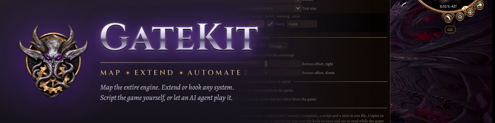
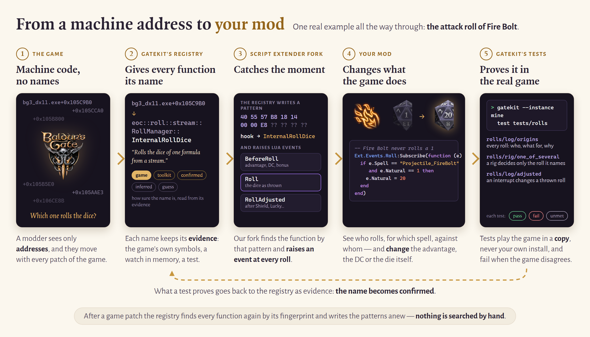

<p align="center">
  
</p>

<p align="center">
  
  
  
</p>

# GateKit

A toolkit that drives Baldur's Gate 3 from outside: it starts copies of the game, runs tests inside
them, serves them to AI agents over MCP, and builds databases of the game's data and code on your
own machine.

## How it helps a modder

<picture>
  <source media="(prefers-color-scheme: dark)" srcset="docs/images/how-gatekit-helps-dark.png">
  
</picture>

- **The game** is machine code: a modder sees addresses such as `bg3_dx11.exe+0x105C9B0`, and they move with every patch.
- **The registry** names each function, type and field - here `eoc::roll::stream::RollManager::InternalRollDice`, the function that rolls the dice - and keeps the evidence for every name. → [registry/README.md](registry/README.md)
- **The Script Extender fork** finds that function by a byte pattern the registry writes, hooks it and raises `BeforeRoll`, `Roll` and `RollAdjusted` at every roll. → [GATEKIT.md](https://github.com/bg3gk/bg3se/blob/gatekit-v34/GATEKIT.md)
- **Your mod** reads who rolls, for which spell and against whom, and changes the advantage, the DC or the die itself.
- **The tests** play it in a copy of the game; what they prove becomes the registry's evidence, and after a patch the registry finds every function again by its fingerprint. → [docs/writing-tests.md](docs/writing-tests.md)

**Requirements:** your own Baldur's Gate 3 (Patch 8), [.NET 10 SDK](https://dotnet.microsoft.com/download),
and [Script Extender](https://github.com/Norbyte/bg3se) installed in the game. Windows; Linux
through Proton is written and not yet tested.

## Quick start

In a clone of this repository. Every game command names a copy of its own (`--instance`), so the
game you play is never touched; a command that would write into the installed game refuses unless
it is named with `--installed-game`:

```bash
./gatekit doctor
./gatekit se install
./gatekit --instance mine up --level GustavX:Basic_Level_A
./gatekit --instance mine exec server "return GK.Party()"
./gatekit --instance mine down
```

`doctor` says what it found and how to fix what is missing. `se install` fetches GateKit's build of
Script Extender. [Getting started](docs/getting-started.md) goes through it step by step.

## Three ways in

- **Drive the game from an agent.** `gatekit mcp` serves a copy to any MCP client; the
  repository's `.mcp.json` registers it. → [docs/driving-the-game.md](docs/driving-the-game.md)
- **Let an agent play.** GateKit AI gives a model four tools - begin a session, act, look, direct
  a scene - each answer saying what changed since the last; `gatekit --instance <copy> mcp --only
  ai_` serves them. → [mods/AI/README.md](mods/AI/README.md)
- **Write a test.** A test is a Lua file in `tests/` that runs in a copy, preferably in the
  sandbox level, and passes, fails or reports a precondition unmet. → [docs/writing-tests.md](docs/writing-tests.md)
- **Read the engine's code.** The game index, the symbol and pseudo-code databases, the wiki
  reader and the memory instrument answer questions about the game, most with no game running.
  → [docs/offline-databases.md](docs/offline-databases.md)

## What it is made of

- **One home.** Everything GateKit keeps lives in one folder, named in `gatekit.json` and found
  from any checkout; `gatekit doctor` lists every location. → [docs/design/home.md](docs/design/home.md)
- **Copies.** A copy starts bare (the base game and GateKit's mods), has its own saves and
  settings; `gatekit game verify` holds an install to Steam's manifests or a reference list.
  → [docs/concepts.md](docs/concepts.md)
- **The event log.** What happens in the game, as one stream, with attention as the view of what
  waits for an answer. → [docs/contracts/bridge-protocol.md](docs/contracts/bridge-protocol.md)
- **The API inside the game.** `GK.*`, every verb fair, cheat or observation.
  → [docs/api-rules.md](docs/api-rules.md), [docs/contracts/lua-api.md](docs/contracts/lua-api.md)
- **The registry.** Our reading of the game's machine code, one entry per function, type and
  global, with its evidence and its place in every build. → [registry/README.md](registry/README.md)
- **The Script Extender fork** it builds on: [bg3gk/bg3se](https://github.com/bg3gk/bg3se); what
  it adds for any modder - roll events, the game's chance of a roll, client-only figures and
  effects, injected input, the game's functions by the registry's names - is its
  [GATEKIT.md](https://github.com/bg3gk/bg3se/blob/gatekit-v34/GATEKIT.md).

All documents: [docs/](docs/README.md). Changing GateKit itself: [AGENTS.md](AGENTS.md) and
[CONTRIBUTING.md](CONTRIBUTING.md).

---

An unofficial fan project, not affiliated with Larian Studios. It contains no game data: you need
your own copy of the game.
